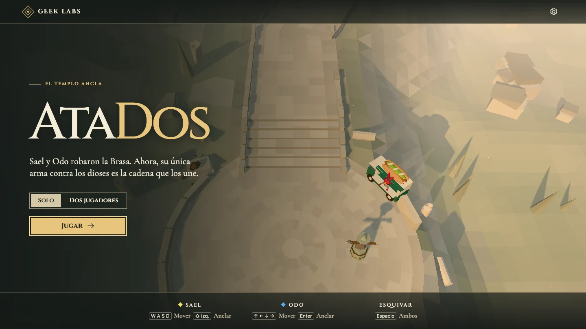
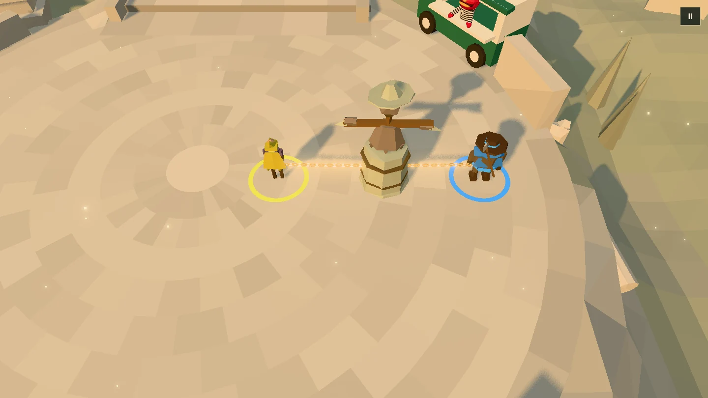

# AtaDos

Sael y Odo robaron la Brasa. Ahora se enfrentan a los dioses con una sola arma, la cadena que los une. Puedes jugar solo o compartir el teclado con otra persona.



## Instalar y jugar

Necesitas Node.js 24 con npm y un navegador de escritorio con WebGL 2. [Descargar Node.js](https://nodejs.org/es/download)

1. En GitHub, abre **Code → Download ZIP** y descomprime el archivo.
2. Abre una terminal en la carpeta que contiene `package.json` y ejecuta estos dos comandos.

   ```sh
   npm ci
   npm run dev
   ```

3. Abre la dirección que aparece en la terminal (normalmente `http://localhost:5173`). Elige **Solo** o **Dos jugadores** y pulsa **Jugar**.

Deja la terminal abierta mientras juegas. Para cerrar el servidor, pulsa Ctrl+C. Para volver a jugar otro día, ejecuta `npm run dev` desde la misma carpeta.

## Cómo jugar

Prueba la cadena con el muñeco de paja al pie del templo. Mueve a Sael a un lado y a Odo al otro. Al atravesar al muñeco, la cadena lo golpea. Si está tensa, corta más. También puedes anclar a uno en su sitio y girar con el otro. Cuando quieras seguir, sube la escalinata.



| Acción | Sael | Odo |
| --- | --- | --- |
| Moverse | W, A, S, D | Flechas |
| Anclarse | Mantener Shift izquierdo | Mantener Enter |
| Esquivar | Espacio | Shift derecho |

En **Solo** controlas a los dos y **Espacio** hace que ambos esquiven. **Esc** pausa la partida. En **Ajustes** puedes cambiar las teclas y consultar los controles de mando.

Un juego de Geek Labs. [Créditos](CREDITS.md)
